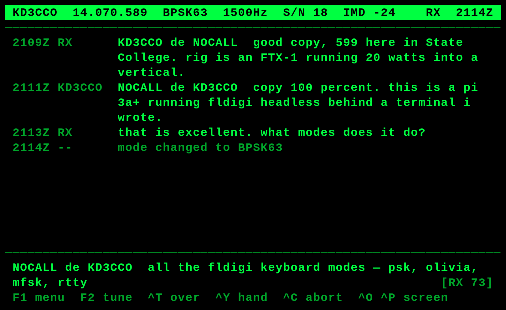
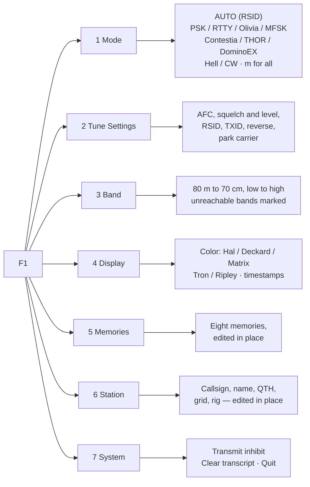
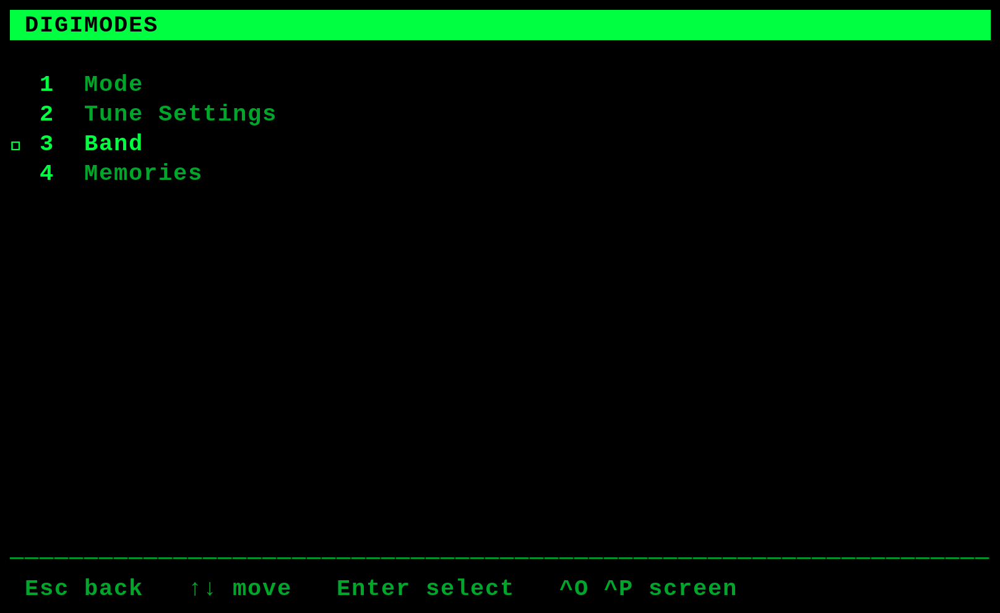
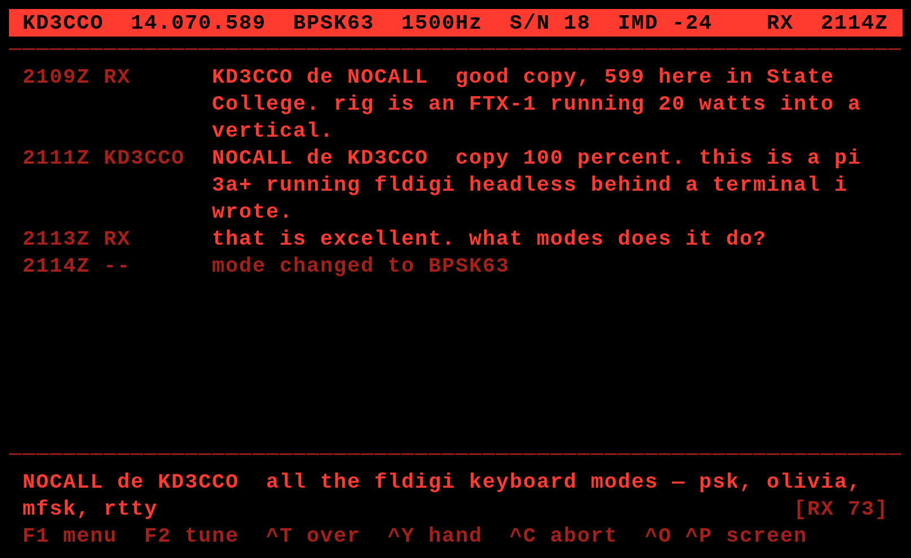
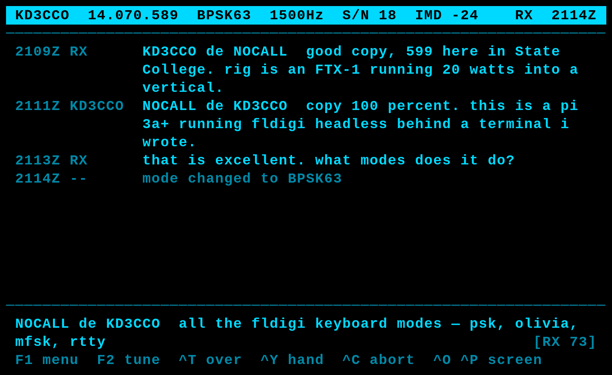

# Digital modes — design, KD3CCO

Keyboard-to-keyboard conversation in fldigi's digital modes: the application
the deck was built for, and the one the other three were added beside.

One of four application design documents. The others are
[`deck_rig_design.md`](deck_rig_design.md),
[`qso_log_design.md`](qso_log_design.md) and
[`wspr_design.md`](wspr_design.md).

**Sections 1-10 are the application design. Sections 5, 6 and 8 at the end
are the detail**, moved here from the platform document because they are
about this application and nothing else.

**Those three keep their original numbers.** §5, §5.4, §6, §8, §8.1 and the
rest mean what they always meant — thirty-one places in the source and the
documentation cite them by number, and renumbering would have turned a file
move into an archaeology exercise. So this document has two numbering
schemes, which is ugly and is the lesser evil.

What is NOT here: requirements, hardware, the software architecture, rig
control, transmit safety, the boot and service model, configuration, and the
record of what was measured and what broke. Those are the platform's, in
[`platform_design.md`](platform_design.md), and the three other
applications reference them too.

## 1. What it is

A terminal for having a conversation over HF, typed, in a digital mode, with
no window manager and no mouse. fldigi does the modulation and demodulation;
this is the operator's side of it.

**It is a conversation and not messaging.** Once an over is running,
characters go out as they are typed — corrections, backspaces and hesitation
included. That is what makes it keyboard-to-keyboard rather than a message
composer that transmits finished lines.

Deliberately not: Cabrillo, weak-signal modes, a waterfall, image modes, or
packet. WSPR arrived as its own application rather than as a mode here, for
the reasons in [`wspr_design.md`](wspr_design.md) §2.

## 2. The over model, which is the whole shape of it

```
compose while receiving  ->  Ctrl-T starts the over  ->  Ctrl-Y hands back
```

**`Enter` inserts a newline. It does not transmit.** This is the single most
important thing about the interface and it is not what intuition suggests.
Sending a line at a time would key the radio dozens of times per contact,
and every turnaround costs seconds of settling at both ends.

So the compose buffer accumulates while the other station is sending, the
buffer indicator shows how much is waiting — `[RX 47]` — and `Ctrl-T` starts
the over with what has been typed. `Ctrl-Y` says "over to you": fldigi
finishes draining the buffer and drops to receive by itself.

`platform_design.md` §5.4 has the reasoning and the alternatives that were
rejected. `src/session.py` is the implementation and is free of curses, so
the behavior is testable without a terminal.

### The three transmit states are the radio's, not the program's

The status line reports `RX`, `TX`, `DRAIN` and `INH`. **`DRAIN` is the one
that earns its place**: after `Ctrl-Y` the operator's over is finished but
fldigi is still putting it on the air, and a status line that said `RX` then
would be describing an intention rather than a transmitter. NFR-20.

`Ctrl-C` is the stop. `Ctrl-Y` is not — it drops to receive when the buffer
empties, which on CW can be a long time after it is pressed.

## 3. Three screens, flat

The conversation, the tuning screen and the mode picker are **a flat set,
not a tree**. Identifying an unknown signal means going tune, mode, tune,
mode, and a navigation that required `Esc` between each would be the wrong
shape for it.

* **`F2`** reaches the tuning screen from anywhere, and again returns.
* **`F3`** reaches the mode picker from anywhere, and again returns.
* Each is its own way back out, and each goes straight to the other.

**`F1`** opens the digimode menu; **`F4`** cycles the color scheme, as on
every screen. **`F5`–`F12`** insert the eight message memories.

### The decode preview on the tuning screen

The tuning screen's last two rows carry a live tail of what is being
decoded. It **starts empty on every visit**: carrying the previous visit's
decodes in means the first thing shown is text from a different frequency,
which is worse than showing nothing. The preview exists to confirm that what
is being tuned *now* is producing copy.

## 4. Modes

fldigi reports 169 modems, of which 64 are conversational. Offering all 64
makes the menu the problem, so there is a curated first tier — BPSK31,
BPSK63, QPSK31, RTTY, Olivia 8/250 and 8/500, MFSK16, THOR22, Contestia,
DominoEX, Feld Hell, CW — with the rest reachable under "more", grouped by
family.

Two decisions worth carrying forward:

* **Selecting CW does not put the radio into CW.** `RIG_MODE` is applied at
  startup and on band change, not on modem change, so fldigi sends an audio
  tone through the data path. Common and workable, and it does not use the
  radio's CW filters. Making a modem change drive the rig mode would mean
  the deck reaching for the radio's controls on every menu selection, and is
  deliberately not done.
* **A mode change is part of the conversation** and goes into the transcript
  as a marker line.

**The carrier survives a mode change.** fldigi resets it to each modem's own
sweet spot, which is right when starting fresh and wrong for the job this
screen mostly does — trying modes against an unknown signal already tuned
onto. So the carrier is read before the change and written back after;
`c` on the Tune Settings page parks it deliberately, which is the other half
of the same behavior.

## 5. Tuning without a waterfall

The deck has no waterfall and does not want one: 66x20 of a console font is
the wrong instrument for a spectrum display, and the panel is 792x480.

What it has instead:

* **`Ctrl-A` / `Ctrl-D`** nudge the carrier +/- 10 Hz without leaving the
  transcript — on the WASD cluster under the left hand.
* **`Ctrl-W` / `Ctrl-S`** search for the next signal up or down.
* **The tuning screen** for AFC, squelch and level, RSID, TXID, mark/space
  reverse, and the receive hold.

**Not on Ctrl+arrows.** The Linux console cannot send a modified arrow at
all — `TERM=linux` defines no `kUP5` or `kLFT5`, so ncurses sees a plain
`KEY_UP` whether or not Ctrl is held. That would have worked over SSH from
an xterm and silently not on the panel, which is the shape of fault this
project keeps finding.

**Mark/space reverse matters more than it looks.** RTTY on a DATA-U path
needs it, and the deck's first two contacts were RTTY.

`platform_design.md` §8 has the search algorithm and the receive-hold rationale.

### The receive hold after an over

A radio switching from transmit to receive produces garbage for a moment,
and garbage in a transcript is indistinguishable from a correspondent
sending nonsense. So decodes are discarded for `RX_HOLD_MS` after an over,
and then admitted only once a quality metric clears — giving up at
`RX_HOLD_MAX_MS` so a dead band returns to normal rather than staying mute.

Setting `RX_HOLD_MAX_MS = 0` turns the quality gate off and leaves the fixed
window alone. The menu prints that as `off` rather than `0 ms`, because
`0 ms` reads as the opposite of what it does.

## 6. Message memories

Eight, `F5` through `F12`, edited in place from the menu, with token
substitution: `{call}`, `{name}`, `{qth}`, `{grid}`, `{rig}`, `{ant}`,
`{power}`.

* **Inserted at the cursor, not appended.** A memory is usually part of a
  line being written rather than the whole of it.
* **`{power}` substitutes the live reading**, not the configured value, so a
  brag line cannot claim 20 W while the radio is making 5.
* **`Ctrl-Z` undoes an insert** — and is bound as `(26, curses.KEY_SUSPEND)`,
  because `TERM=linux` defines `kspd=^Z` and ncurses returns `KEY_SUSPEND`
  instead of byte 26. Matching only 26 shipped the undo dead on the panel
  once already.

The tokens come from the station fields on the deck-and-rig screen, which is
where they are documented beside their values — see
[`deck_rig_design.md`](deck_rig_design.md) §4.

## 7. Transmit safety

The full treatment is `platform_design.md` §9. The three properties that shape
this application:

* **Inhibit is an interlock against starting, not a stop button.** `Ctrl-B`
  during an over cannot end it; `Ctrl-C` is the stop. The control says so
  rather than leaving it to be inferred from a radio that stays keyed.
* **Enforced locally.** `start_over` returns without calling fldigi while
  inhibited. fldigi's own `main.rx_only` is set too but not relied on — it
  was observed not to stop `main.tune`. A safety property that depends on
  another process behaving as documented is not a safety property.
* **Transmit AND decoding follow the radio's mode.** Leaving a data mode
  inhibits transmit and **stops the decoder** by parking fldigi on its
  `NULL` modem — on a Pi 3A+ that DSP is the largest thing running, and in
  SSB everything it decodes is noise. Decoding resumes by itself; arming
  transmit stays `Ctrl-B`, because a running decoder puts nothing on the air
  and an armed transmitter does.

**A dropped CAT read is not a mode change.** `rig.mode()` returns `""` on a
timeout, and treating that as an answer sent the display to the modem — so
the panel showed `USB`, then `BPSK31`, then `USB`, every few seconds.
`_rig_mode_held` holds the last good reading for eight seconds and then
admits the absence.

## 8. What this application cedes to the others

* **The log.** Contacts are the logger's, on its own screen and its own
  ring stop. The digimode screen contributes the mode and the frequency to a
  record and nothing else. [`qso_log_design.md`](qso_log_design.md).
* **The station settings.** Edited on the deck-and-rig screen, which is also
  the screen the deck opens on. [`deck_rig_design.md`](deck_rig_design.md).
* **The sound card, while WSPR runs.** The codec is exclusive — measured —
  so entering WSPR stops fldigi outright and this application is
  unavailable until WSPR is stopped. [`wspr_design.md`](wspr_design.md) §2.

## 9. Testing

| Property | Tested by |
|---|---|
| the over model, the buffer, the transcript | `src/session.py` through `tests/test_session.py`, no terminal |
| every screen at every width | the pure renderers in `src/render.py` |
| the menus and their state words | `src/menus.py`, pure |
| which handler gets a keystroke | `tests/test_menu_arrows.py`, `test_menu_nav.py`, `test_screen_toggles.py`, through a real pty |
| key bytes under the console's terminfo | the pty tests, **under `TERM=linux` as well as xterm** |
| a cold boot with fldigi arriving late | `tests/test_cold_boot.py`, with a stand-in fldigi started on a timer |
| the decoder park and the mode interlock | `tests/test_decode_park.py`, both signals driven at the real program |

**`TERM=linux` is not optional in those tests.** The deck is a framebuffer
console whose terminfo captures control bytes xterm passes through, and the
memory-insert undo shipped dead on the panel while passing every xterm test.
`tests/test_console_keys.py` exists for that class of fault alone.

## 10. Status

The deck has made contacts. First two on 2026-09-19, 80 m RTTY during a
sprint; BPSK31 the next day; and DX into Martinique on 40 m BPSK31 at 20 W
on 2026-09-21, about 2,100 miles. Found with `Ctrl-W`/`Ctrl-S` rather than a
waterfall, which was §8's premise tested against a live band.

`platform_design.md` §14 separates what is verified from what is assumed, and
§15 holds the open questions.

---

# The detail

Moved from the platform document, 2026-10-17. **Original numbering
preserved**, so every `§5.4`-style citation in the source still resolves.
These three sections are the long-form design for the interface, the modes
and the tuning; sections 1-10 above are the application-level view of the
same thing.

## 5. The interface

### 5.1 Layout

At the proposed 66×20 grid. These are rendered from the running code, not
drawn by hand: `tools/capture_screens.py` produces the text and `tools/capture_png.py`
renders it to PNG using each scheme's own colors.



`[RX 47]` is the buffer indicator described in section 5.4: 47 characters
composed while receiving, not yet transmitted.

Three regions, fixed:

1. **Status line**, one row, always visible.
2. **Transcript**, everything between, scrolling upward.
3. **Compose**, one to three rows at the bottom with the cursor in it.

### 5.2 Status line fields

Left to right: own callsign, rig frequency, modem name, audio carrier, and both
of fldigi's status readouts; transmit state and UTC are right-aligned.

**The radio's own sideband mode is deliberately absent.** It was shown until
2026-09-27, where it cost the seven columns that fldigi's second readout needed
at 66. The trade favours the readout: the rig mode is legible on the radio's
front panel, changes about twice a session, and remains on the tuning screen
beside the frequency, whereas the second readout is IMD under PSK — the only
indication the deck gives that the transmitter is being overdriven — and
becomes the signal-to-noise figure under RTTY, where the first readout is baud
and shift instead. Dropping it therefore cost the S/N reading outright on that
mode, which is what makes this more than a preference.

Everything fits at 66 columns. Narrower terminals drop IMD first, then S/N,
carrier, frequency and modem in that order; callsign, transmit state and the
clock never drop. Transmit state is the one field that changes appearance
rather than only content — see section 9.

**The transmit state reports the radio, not this program.** Four values:

| | |
|---|---|
| `RX` | Receiving |
| `TX` | Transmitting, with an over still being composed into it |
| `DRAIN` | Handed back, and the buffer is still going out — the radio is keyed |
| `INH` | Transmit inhibited |

The status field reports fldigi's transmit state, not the session's. The two
differ during `DRAIN`: `Ctrl-Y` does not unkey the radio, it marks fldigi's
buffer "receive when drained", and everything already composed still has to be
sent — minutes, for a long over at 31 baud.

*Why it is fldigi's state.* Deriving the field from the session showed `RX`
throughout that window, which says the radio is silent while it is
transmitting, and made a stuck transmission invisible (§9).

### 5.3 Transcript

Received text arrives character by character, so a line is rendered as it
arrives rather than buffered until complete. Sent text is interleaved in the same
column layout, distinguished by the callsign column rather than by color, since
the display is monochrome.

Timestamps in UTC without colons — `2114Z` — because it reads as a radio log and
saves two columns.

Scrollback is bounded in lines, held in memory, with `PgUp`/`PgDn` to review and
any keypress in the compose line returning to the live tail.

### 5.4 Compose, and how an over works

**Decided: the over-based model, which is both fldigi's norm and the on-air
norm.** It is not line-and-Enter, and the reasoning is worth recording because
line-and-Enter is the intuitive guess.

HF digital is half-duplex with long overs. One station transmits a paragraph and
hands back; the other cannot type meanwhile, and every turnaround costs seconds of
transmitter and receiver settling. Sending a line at a time would key the rig
dozens of times per QSO to no purpose. The convention across PSK, RTTY, Olivia,
MFSK and the rest is identical — there is no per-mode default to inherit.

The cycle:

| Step | Key | What happens |
|---|---|---|
| Compose while receiving | — | Text accumulates in the buffer. Nothing is transmitted. `Enter` inserts a newline; it does not send |
| Start the over | `Ctrl-T` | `text.add_tx` sends the buffer to fldigi, `main.tx` keys the rig. Typing continues to go out live, character by character |
| Hand back | `Ctrl-Y` | Appends fldigi's inline `^r` control, which drops to receive once the buffer has drained rather than cutting it off |
| Abort | `Ctrl-C` | `main.abort`, immediately |

The live-typing half of step 2 is the thing that makes this keyboard-to-keyboard
rather than messaging: the other operator watches the text appear as it is typed,
corrections included.

**Latency varies by mode even though the mechanism does not.** PSK31 and RTTY put
characters on the air essentially as typed. Olivia and MFSK interleave across
several seconds, so text arrives at the far end in lumps regardless. The status
line shows transmit state; it cannot show how far behind the far end is.

The compose region carries a buffer indicator — `[RX 47]` while receiving with 47
characters composed, `[TX]` while the buffer is going out — so the state is never
ambiguous. Question 5 asks whether a local-only chat variant is wanted for VHF
work, where Enter-sends is reasonable because turnarounds are cheap.

### 5.5 Showing a transmission as it goes out

fldigi echoes transmitted text back through its RX buffer. That was listed as
an open question in §14 and answered on the air: it does. Read naively it puts
every over in the transcript twice — once from the keyboard, once as though a
correspondent had sent it — which is how it was first noticed.

The echo is not noise, though. It is the only confirmation of what has
**actually reached the air**, arriving character by character at the modem's
own rate, and on an abort it is the only record of how much went out before
`Ctrl-C`. Three ways to present it were considered.

**A. Both lines, permanently.** The over as typed, attributed to this station,
and a `TX` line beneath it built from the echo. Simple, and the two lines can
disagree — which is exactly what you want to see on an abort or a stalled
buffer. The cost is screen: every over takes twice the transcript on a
20-row panel, roughly 13 rows of visible history, so an exchange that fits
today scrolls away. Once an over completes the two lines are usually
identical and the second has stopped earning its place.

**B. Transient progress — implemented.** The over as typed appears at
`Ctrl-T`. Beneath it, a `TX` line built from the echo grows while fldigi
sends, and **disappears when the over completes**, leaving one clean entry.
Live progress and divergence-detection while it matters; a compact log
afterwards. The `TX` line is not a session entry at all — it is assembled at
draw time from a string held by the terminal, so nothing has to be removed
from the transcript later.

The exception is an abort: `Ctrl-C` writes what was actually sent into the
transcript as a marker (`aborted — sent: ...`) before clearing the transient
line, because that is the one case where intent and reality differ and the
difference is worth keeping.

**C. Echo only.** No line at `Ctrl-T`; the transcript entry is built solely
from the echo. The most truthful — the log shows what reached the air and
nothing else — and the most compact. It was rejected because it gives no
acknowledgement that `Ctrl-T` registered until the first character comes back,
and no record of intent to compare against.

Switching between these is small: A is B without clearing `_tx_echo` on
completion and with the transient line promoted to a real entry; C is removing
the `_append` from `Session.start_over()` and `Session.type()` and writing the
echo through a `sent()` method instead.

**How the end of an over is known.** Not `Ctrl-Y` — that only stops adding to
the buffer, and fldigi keeps transmitting until it drains. The signal is
fldigi's own `main.get_trx_state` returning to `RX`, which is also what gates
the echo handling. The transcript marks it `sent`.

### 5.6 Message memories

`F5` to `F12` insert stored text at the cursor. `Ctrl-Z` removes the last
insert and restores the cursor with it.

**Why at the cursor rather than appended.** A memory is usually part of an
over, not the whole of it — a callsign dropped into a sentence, a station
description added after a greeting. Appending would make the operator retype
around it.

**Why `{call}` rather than the callsign.** Memories are substituted from the
station settings at insert time, so changing `CALLSIGN` does not mean editing
eight stored messages. An unknown token is left alone rather than raising: a
memory with a typo in it still inserts, which is better than a key that does
nothing.

**Why there is no text-entry screen.** Setting a memory stores whatever is in
the compose buffer. The operator types the message the ordinary way — with the
line editing, the history recall and the transcript visible — looks at it, and
then puts it in a slot. Building a second, worse editor inside a menu to do
the same job would be the wrong trade on a 66-column screen.

Memories are runtime state: `cyberdeck.conf` provides the starting set, and
anything stored on the deck overrides it and persists (§11).

Mid-over an insert is **sent**, not buffered, exactly as typing is — and
therefore cannot be undone. `undo()` refuses rather than pretending.

### 5.7 Key bindings

| Key | Action |
|---|---|
| `F1` | Menu |
| `F2` | **Tuning screen, from any screen; again to return to the conversation** |
| `F3` | **Mode picker, from any screen; again to return to the conversation** |
| `F4` | Cycle color scheme |
| `F5`–`F12` | Insert message memory 5-12 at the cursor |
| `Ctrl-T` | Start the over |
| `Ctrl-Y` | Hand back — append `^r`, drop to receive when the buffer drains |
| `Ctrl-C` | Abort transmit immediately |
| `Ctrl-Z` | Undo the last memory insert |
| `Ctrl-A` `Ctrl-D` | Carrier −10 / +10 Hz |
| `Ctrl-W` `Ctrl-S` | Search for the next signal, up / down |
| `Ctrl-B` | Transmit inhibit, from any screen |
| `Ctrl-X` | Clear the transcript |
| `←` `→` `Home` `End` | Move within the composed line |
| `↑` `↓` | Recall previously sent overs |
| `PgUp` / `PgDn` | Scroll the transcript |
| `Ctrl-L` | Redraw |
| `Ctrl-Q` | Restart the terminal, after a confirmation |
| *drag* | Scroll the transcript on the touchscreen (§17.1) |
| *tap* | Choose, on the pairing and no-keyboard screens only |
| `Esc` | Close any panel; from the tuning screen, back to chat |

`F2` is a full-screen mode toggle rather than an overlay, for the reason in
section 8: on a 66-column panel a tuning display worth reading does not fit
alongside a conversation worth reading.

**The three screens are a flat set, not a tree.** Conversation, tuning and mode
are reachable from each other in one keystroke, and `F2` and `F3` are each
their own way back. The operating loop that motivates it is signal
identification: hear something unfamiliar, tune it, try a mode, look at the
decode, try another. That is tune → mode → tune → mode, and a navigation where
each step needs `Esc` first turns a two-key loop into a four-key one. Selecting
a mode returns to whichever screen the picker was opened from, so the loop
closes where it started.

**`Ctrl-Q` is a restart, and says so.** On the deck the systemd unit is
`Restart=always`, so leaving the main loop does not stop anything: the process
exits, the panel goes dark for `RestartSec`, and the terminal comes back. There
is no desktop underneath to return to and no way to relaunch from the panel, so
quitting for good is not something the deck can offer. Unannounced, that is a
few seconds of blank screen indistinguishable from a crash — it was read as
one. It now asks for a second `Ctrl-Q` and names what will happen. The
confirmation read has to set its own timeout: with the main loop's `POLL_MS`
still in force it returns `-1` within a fifth of a second and cancels itself.

**Tuning on `Ctrl-W/A/S/D`, not on `Ctrl`+arrows.** The Linux console cannot
report a modified arrow at all — `TERM=linux` defines no `kUP5` or `kLFT5`, so
ncurses sees a plain `KEY_UP` whether or not Ctrl is held. That binding would
have worked over SSH from a terminal emulator and silently failed on the
panel, which is worse than not offering it. The WASD cluster sits under the
left hand while the right stays on the text.

**These four are not on the hint line.** There is not room at 66 columns for
everything, and they are listed in Tune Settings (`F1` → `2`) instead —
beside the settings they relate to.

**A memory is stored on one line and may be sent as several.** Both places it
can live are line-based — `cyberdeck.conf` is `KEY = value`, and the on-deck
editor takes Enter to mean save — so a literal newline cannot be typed into
either. `\n` is expanded at the moment of insertion, which keeps the stored
form single-line everywhere and leaves the editor showing exactly what was
typed. Multi-line memories are how PSK31 is actually worked: a station
description arrives as a formatted block, not as one long line the far end has
to unwrap.

**Command keys are case-folded.** RTTY is Baudot and has no lowercase, so
every RTTY operator works with Caps Lock on; a command key that stops working
in the mode the deck is most used for is not an edge case. §14 records the
evening this cost.

### 5.8 Menu tree



Menus are full-screen overlays, not nested pointers. Every entry takes a
single key, and the arrows walk a `▸` marker with `Enter` to choose — both
paths dispatch through the same code, so they cannot drift apart.

**Two menus edit in place** rather than sending the operator to a config file:
Memories and Station both open the same line editor on `Enter`. That editor is
the deck's only text-entry surface outside the compose line, and it is
deliberately the same shape: a cursor, `Ctrl-U` to clear, `Enter` to keep,
`Esc` to discard.

**Station shows each field beside its token** — `Callsign {call} : KD3CCO` —
because the moment an operator wants to know that `{grid}` exists is the
moment they are looking at what the grid is set to.




### 5.9 Color schemes

Five, each a single hue on black — or in one case no hue at all:

| Scheme | Hue | Bright | Dim | Evokes |
|---|---|---|---|---|
| **Matrix** | green | `#00FF41` | `#00A62A` | the digital rain; a more saturated green than P1 phosphor |
| **Deckard** | amber | `#FFB000` | `#B27B00` | P3 phosphor, the Esper and the VDUs around it |
| **Hal** | red | `#FF3B30` | `#A62018` | the 9000-series eye; also the night-vision scheme |
| **Tron** | cyan-blue | `#00D9FF` | `#0089A8` | the Grid |
| **Ripley** | none | `#FFFFFF` | `#A0A0A0` | the Nostromo's own screens; plain white on black |

**Ripley is the oldest meaning of monochrome**: one intensity axis and no hue,
which makes it the most legible of the five in daylight and the obvious choice
for anyone who finds a colored console tiring. It is also the only scheme that
redefines the console's *own* default foreground — entry 7, and 15 through
`A_BOLD` — rather than a color the console was not otherwise using. That is
safe here because the deck owns `tty1` and `colors.restore()` puts the table
back on exit, but it is the reason the restore exists at all rather than being
merely tidy.

Two of the colored schemes carry a legibility caveat worth recording rather
than discovering.

**Hal is the least legible of them.** Red has the lowest luminance of any
saturated hue, so red-on-black has the poorest contrast here even at full
brightness. That is inherent to the choice and is also the point — it is the
scheme for operating at night without wrecking dark adaptation. It is not the one
to default to.

**Tron is cyan-shifted deliberately.** A true blue on black (`#0000FF`) is close
to unreadable as body text: the eye has few blue-sensitive cones near the fovea
and the shorter wavelength focuses differently from the rest of the image, so
blue text on black shimmers. Pulling it toward cyan keeps the Tron look and gives
it luminance to work with.

**Matrix is the proposed default** — green on black has the best contrast of the
four and the longest history as a terminal phosphor.

The same screen in each, rendered at the schemes' own hex values rather than a
terminal emulator's approximation of them:

| | |
|---|---|
| Hal | Deckard |
|  |  |
| Matrix | Tron |
|  |  |

Monochrome means one hue, not one intensity. Emphasis comes from the dim
variant and from reverse video: the status line is reverse, own transmissions
and received text are full brightness, timestamps and the callsign column are
dim.

**Two corrections from running it on the panel**, both the same mistake:

* Reverse video must be a color pair defined outright as **black on the hue**,
  not a normal pair plus `A_REVERSE`, and never with `A_BOLD`. Combining the
  two puts the bold intensity on what becomes the background, and the status
  line renders as a solid block of color with text the same hue as the bar it
  sits on — unreadable, and indistinguishable from an empty bar.
* **Menu selection is not reverse video.** Even done correctly it disappeared
  into its own highlight on this panel. Selection is a `▸` marker plus a step
  from dim to bright, which carries the same information without depending on
  how a console renders an attribute.

* **The palette redefinition was addressing nothing.** `apply()` wrote the
  `OSC P` sequences for entries 8 and 9, then built its color pairs out of
  `scheme["ansi"]` — so nothing ever drew with the entries it had just
  defined. Every scheme rendered as its ANSI approximation. Matrix, Hal and
  Tron survived that, because ANSI green, red and cyan are close enough to the
  intent; **Deckard did not**, because amber is precisely the hue ANSI cannot
  approximate. This document predicted that outcome as the fallback and then
  the code delivered it everywhere.

  The correct entries are not free choice. On the Linux console a color pair
  can only name entries **0-7**; 8-15 are reachable for a foreground only via
  `A_BOLD`, which the console implements by adding 8, and are not reachable at
  all for a background. So the two entries a scheme must redefine are the ANSI
  index itself, for dim text, and that index **+ 8**, for bright:

  | Scheme | ANSI | dim entry | bright entry |
  |---|---|---|---|
  | Matrix | 2 | 2 | 10 |
  | Deckard | 3 | 3 | 11 |
  | Hal | 1 | 1 | 9 |
  | Tron | 6 | 6 | 14 |

  A first attempt at this fix gated on `curses.COLORS >= 16` so it could name
  entries 8 and 9 directly. `TERM=linux` reports **8** colors, so that gate is
  always false and the correction would have changed nothing — the same bug
  with a new guard. Caught before it shipped only by checking the terminfo.

* **`OSC P` does not work on this panel at all**, which is why none of the
  above could have helped on its own. It is a VGA-console feature; the panel
  runs fbcon on the vc4 DRM driver, which ignores the sequence. Proven by
  writing it straight to `/dev/tty1` and watching nothing change — and that
  result explains the original symptom completely: every scheme had been
  rendering as the stock console palette since the beginning. Red and cyan
  passed as acceptable because the console's defaults are close to the intent;
  green read as dull and entry 3's brown-to-yellow pair was never going to
  look like amber.

  The working mechanism is the **`PIO_CMAP` ioctl**, which is what
  `setvtrgb(1)` uses. It takes all sixteen entries at once as 48 bytes of
  R,G,B, so `colors.py` reads the current table, replaces three entries and
  writes it back. `OSC P` is kept as a fallback for a console that honors it.

  §14 listed "OSC P palette redefinition works on this panel's console" as
  assumed and untested. It is now tested, and it was false.

  The reverse-video bar gets **its own entry**. A background cannot reach
  8-15, but it can name any of 0-7, so the bar is not obliged to share the
  scheme's dim entry: entry **5** is given over to it and redefined to the
  scheme's bright hex. The status bar is therefore full brightness while dim
  text stays dim. Entry 5 is free — the schemes use 1, 2, 3 and 6 — and this
  program owns the console.

* **Changing a scheme did not recolor the screen.** Redefining a palette entry
  recolors nothing already drawn: fbcon resolves a glyph's color when it is
  written to the framebuffer, not at scan-out. And ncurses rewrites a cell only
  when its character or its *attribute* changed — where an attribute carries
  the color-pair **number**, not the pair's definition. Redefining pair 3 in
  place therefore left every cell byte-identical, so ncurses skipped them all.

  The symptom was unmistakable once seen: after switching to Hal, only the
  digits that happened to change value came out red, while the rest of the
  status bar stayed the previous scheme's green. Body text appeared to work,
  because a transcript changes constantly; the status bar did not, because its
  text is static.

  `clearok()` was tried first and was not reliable. The fix is to give **each
  scheme its own pair numbers** — Hal 1-3, Deckard 4-6, Matrix 7-9, Tron 10-12
  — so that switching scheme changes every cell's attribute and ncurses has no
  choice but to rewrite the screen.

The general rule the panel taught: on a console whose attribute handling is not
under test, encode state in *characters and intensity*, and use filled bars
only where the contrast is defined explicitly.

A second, sharper rule from the palette work: **on this console a color change
is only ever applied to glyphs drawn after it.** Anything that changes colors
must also force the affected cells to be rewritten.

A second rule, from all three of these: **the PNG screenshots cannot catch
them.** `tools/capture_png.py` draws with the schemes' hex values directly, so it
renders what was intended rather than what the console produces. It is a
design record, not a test. Every one of these three faults was invisible in the
screenshots and obvious on the panel.

Each scheme redefines two Linux console palette entries — one bright, one dim —
with `OSC P` escape sequences (`\033]P<index><rrggbb>`), leaving black as
background. This is what allows a true amber and a true Matrix green rather than
the ANSI approximations of yellow and green, and it is why switching schemes at
runtime is a matter of emitting four escape sequences rather than repainting.
Verification is pending; see section 14.

`F4` cycles Hal → Deckard → Matrix → Tron → Ripley, which is darkest to
brightest as the eye reads them rather than any arithmetic on the values.
The Display menu lists the same order and selects directly, and
`COLOR` in the configuration file sets the scheme at boot.

## 6. Modes

fldigi 4.2.13 reports 169 modems, of which 64 are conversational. Offering all 64
in a menu makes the menu the problem. The proposal is a curated first tier with
the rest reachable under "more":

| Tier | Modems | Rationale |
|---|---|---|
| First | BPSK31, BPSK63, QPSK31, RTTY, Olivia 8/250, Olivia 8/500, MFSK16, THOR22, Contestia, DominoEX (DOMEX8), Feld Hell, CW | Covers ordinary HF keyboard work |
| More | The rest, grouped by family | Complete, and never in the way |

**CW was missing from both tiers and that was a bug, not a choice.** The family
filter that builds the full list had no `CW` prefix, so the mode was
unreachable from the deck at all while "more modes" claimed to be the complete
conversational set. CW is keyboard-to-keyboard operating — the original form of
it — and fldigi offers it as a modem like any other.

Selecting it does **not** put the radio into CW mode: `RIG_MODE` is applied at
startup and on band change, not on modem change, so fldigi sends an audio tone
through the data path. That is workable and common, but it does not use the
radio's CW filters. Making a modem change drive the rig mode is a plausible
future behavior and is deliberately not done yet — it would mean the deck
reaching for the radio's controls on every menu selection.

Mode changes take effect immediately via `modem.set_by_name` and are recorded in
the transcript as a marker line, since a mode change mid-QSO is part of the
conversation.

## 8. Tuning

Two different things get tuned, and conflating them is what made this look like
the hardest problem in the design. It is not.

**1. Where the receiver's passband sits — the radio's job.** The FTX-1 has its
own spectrum scope and waterfall, and rendering a spectrum on an 800×480 panel
from a 512 MB Pi was never going to beat it. Choosing a band segment and seeing
whether 14.070 is busy happens on the radio's display, where it has always
happened.

**2. Which signal inside the passband fldigi decodes — the deck's job.** fldigi
demodulates one narrow signal at one audio frequency within the 3 kHz passband.
The radio's waterfall shows RF and cannot set that audio carrier.

The operating technique that connects the two, and makes the second one nearly
free:

> Park fldigi's carrier at a fixed audio offset — 1500 Hz — and leave it there.
> Use the radio's waterfall and VFO to bring the wanted signal to that offset.
> AFC holds it once it is close.

### 8.1 That technique does not survive contact with the radio

It is ordinary practice with narrow filters and it reads well. In use it is the
wrong way round.

The FTX-1's narrowest waterfall span is about **5 kHz**. Across a few hundred
pixels that is tens of hertz per pixel, and a BPSK31 signal is 31 Hz wide — one
pixel, perhaps two. Landing that on a specific audio offset by turning a knob
and watching a display at that scale is not a task the operator should be given.

The inversion is this: **hold the VFO still and move the carrier.** fldigi's own
`modem.search_up` / `search_down` find the next signal in the received audio
and land the carrier on it to the hertz, which no amount of knob-turning
matches. The dial is then set once per band and left alone, and the VFO knob is
for changing bands or for reaching activity outside the current passband.

So the deck binds `↑` `↓` to search and `←` `→` to a ten-hertz nudge, and binds
them **on the conversation screen as well as the tuning screen**. That second
part matters more than it looks: the tuning screen shows the carrier but hides
the transcript, so tuning there is done blind. A carrier number that looks
right while nothing decodes is not tuned. The decoded text is the only
confirmation that counts, so the keys have to work where the text is.

The consequence for the operator is a shorter procedure than the original
technique: set the band, press `↑`, read.

Two things the deck has to say out loud, because there is no waterfall to make
them obvious:

* A carrier move produces **nothing** on the radio — no dial change, no
  waterfall shift. Without a spectrum display, a key that changes an invisible
  number is indistinguishable from a dead key.
* A search that finds nothing has to say so. `search up: nothing found above
  the squelch; still 1832 Hz` separates a quiet band from a broken binding.

Three fldigi facilities back it up when the offset technique is inconvenient:

* **RSID** (`main.set_rsid`) acts on a Reed-Solomon Identifier: a short burst a
  station sends ahead of its over encoding the mode *and* the audio frequency.
  With it on, the deck switches to match, which on a quiet band is the whole
  problem solved without touching anything.

  It is the nearest thing fldigi has to automatic mode detection, and the
  distinction matters: **nothing is deduced from the signal itself**. A station
  that sends no identifier is not followed, and a mode has to be found by hand
  as before. fldigi has no blind mode recognizer.

  **TXID** (`main.set_txid`) is the other half and a separate setting: it sends
  an identifier ahead of the deck's own overs so that others can follow it.
  Both are exposed on the tuning screen, `r` and `x`. Leaving RSID on while
  TXID is off is taking without giving.
* **`modem.search_up` / `search_down`** step to the next detected signal within
  the passband.
* **`modem.get_quality`**, 0–100, gives a number to peak against — tuning by
  meter rather than by eye.

**No software spectrum is built.** fldigi's XML-RPC does not expose its FFT, so
rendering one would mean reading the audio separately, which would mean sharing
the ALSA capture device with fldigi through `dsnoop`. That complexity buys a
worse version of a display the radio already has.

### 8.2 The tuning screen

`F2` toggles the whole screen between chat and tuning, rather than overlaying a
panel. On 66 columns a tuning display worth reading and a conversation worth
reading do not coexist.

Since §8.1 moved tuning onto the conversation screen, this screen's job has
narrowed: it is for **reading the numbers**, not for tuning. Carrier, signal
width, S/N, IMD and the quality bar in one place, for answering *how good is
this decode* — a question the transcript alone does not answer.


### 8.3 Band presets

Eleven, low to high, from 80 m to 70 cm. The HF entries are the long-standing
PSK31 watering holes; 6 m, 2 m and 70 cm are the PSK31 calling frequencies —
50.290, 144.144 and 432.200.

**A band the radio cannot reach is shown, marked, not hidden.** A list that
silently varies with the hardware leaves the operator unable to tell "this
deck does not know about 70 cm" from "this radio cannot do 70 cm". Which band
belongs to which is `RIG_BANDS` in `cyberdeck.conf`; empty means all of them,
which is right for the FTX-1.

**It is configured rather than probed.** hamlib can report a rig's frequency
ranges through `dump_caps`, which would make this automatic. It is not used:
the parsing is untested against real hardware, and a wrong answer here hides a
band the operator can actually use — a failure that looks like the deck being
broken rather than like a bad guess.

The VHF and UHF entries sit in the weak-signal SSB segments, so the radio must
be in USB rather than FM. `RIG_MODE = PKTUSB` covers it, which is one more
reason that setting exists.

### 8.4 The decode preview

The screen's last two lines are a tail of what is being decoded, live. Text
fills the lower row; when it reaches the edge the row above takes what came
before and the lower one starts again empty.

**The preview is emptied on every visit to the screen.** Carrying the last
visit's text in means the first thing shown while tuning is copy from a
different frequency, which is worse than showing nothing: the point of the
display is to answer what is being demodulated *now*.

Two lines rather than one because half a line of words is not a result. A full
line either reads as English or it does not, and that judgement is the whole
purpose of the display.

It exists because the numbers on this screen cannot answer the two questions
tuning actually poses. Signal quality and S/N say a signal is present and
strong; they say nothing about whether it is being *demodulated correctly*. On
RTTY through a DATA-U path the mark and space tones arrive swapped, and the
result is a confident quality bar over a stream of plausible letters that never
form words — indistinguishable, by the numbers, from good copy.

So the instrument for that is the text itself:

| What the line shows | What it means |
|---|---|
| Words | Tuned, and the sense is right |
| Plausible letters, no words | Press `v` — mark/space reversed |
| Noise, or nothing | The carrier is not on a signal; search again |

This also closes the loop on squelch, which `+` and `-` adjust from this screen
for the same reason: setting it just above the noise floor is what separates
fragments from copy, and it is far quicker done while watching the decode than
guessed at from a menu. Both were learned on the air before they were built —
§14 records the first two contacts, where exactly these two adjustments were
what made them possible.

The quality bar refreshes several times a second. Almost everything here is a
readout from fldigi or `rigctld`, with one exception worth naming:
**signal width is partly computed by the deck**, because `modem.get_bandwidth`
returns 0 for every fixed-bandwidth mode — BPSK31, RTTY, Olivia — and a figure
only where bandwidth is a settable modem parameter, such as Hell. Displaying
that 0 asserts BPSK31 is zero hertz wide. The deck substitutes the definitional
figures only: the PSK family from its symbol rate, Olivia and Contestia from
the name, where the second number *is* the bandwidth. Everything else shows an
em dash rather than a number quoted from memory.

Received text continues to accumulate in the transcript while the tuning screen
is up, and the transcript is intact on return.

### 8.5 The receive hold after an over

RTTY is the mode that forces this. Baudot has no error detection at all — five
bits between a start and a stop bit — so any noise that fits the frame decodes
as a character. When PTT drops the receiver unmutes and the AGC recovers, and
the modem turns that transient into text. It is real audio and fldigi is right
to decode it; it is simply nobody's transmission. The tail of the deck's own
echo lands in the same window.

A fixed timer is the obvious instrument and the wrong one on its own. Long
enough to cover the transient on a quiet band is long enough to swallow the
opening characters of a fast reply in a contest, and a timer cannot tell those
apart. So the timer is only the floor:

* below `RX_HOLD_MS`, always discard — at PTT drop even the quality metric is
  still settling, so there is nothing trustworthy to gate on;
* after that, discard until the modem reports a real signal on two consecutive
  polls. A decaying transient does not sustain; a correspondent answering does;
* give up at `RX_HOLD_MAX_MS`, so a band with nothing on it returns to normal
  behavior instead of blanking indefinitely.

`RX_HOLD_MAX_MS = 0` disables the quality gate and leaves exactly the fixed
window, which is what this did before. Both bounds are adjustable from Tune
Settings — `[` `]` for the floor, `{` `}` for the ceiling — and are kept
ordered, so the pair cannot describe a window that is impossible.

The threshold for "a real signal" is fldigi's own squelch level when squelch is
on, since that is the operator's statement of what counts as one here; a
constant stands in when it is off. The transient has to hold above it rather
than merely touch it, which is what the consecutive-poll count is for.

Nothing is cleared when the hold releases. `poll_rx()` drains and this
discards, so the chunk delivered on release holds only what arrived since the
last poll. Calling `clear_rx()` there would throw away the opening of the very
reply that ended the hold.

