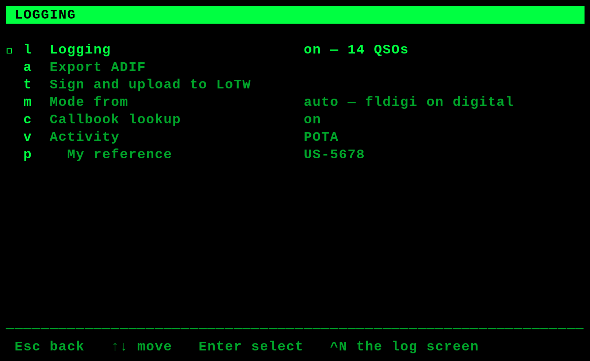
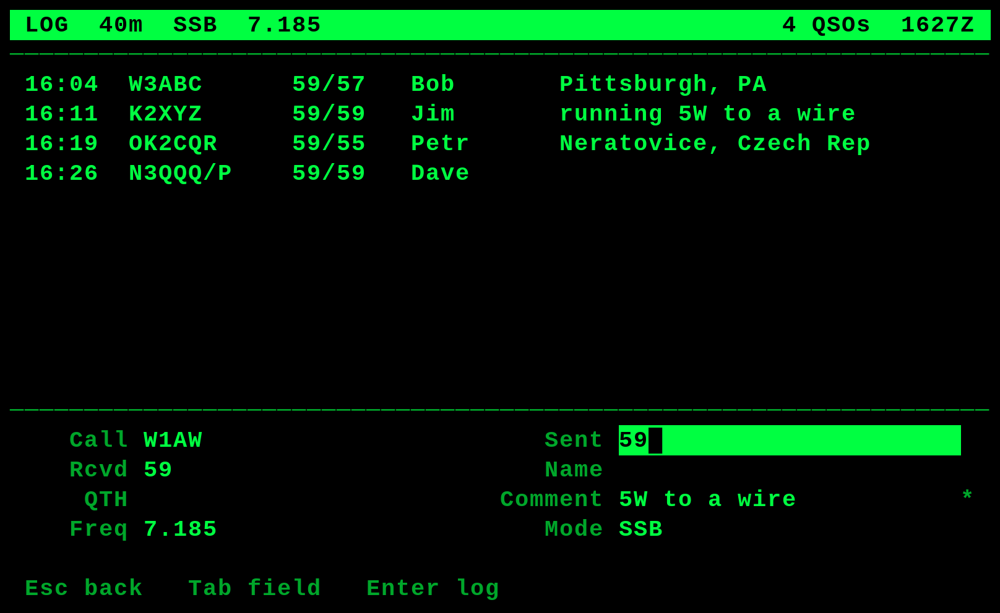
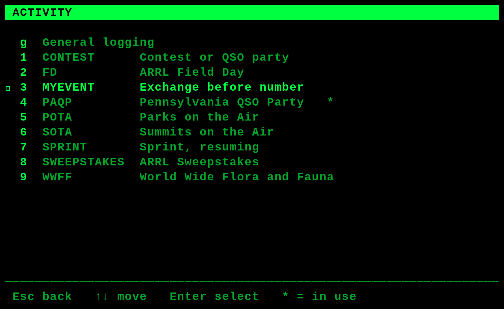
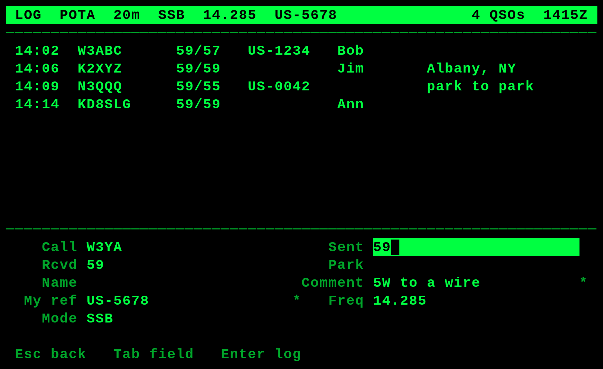
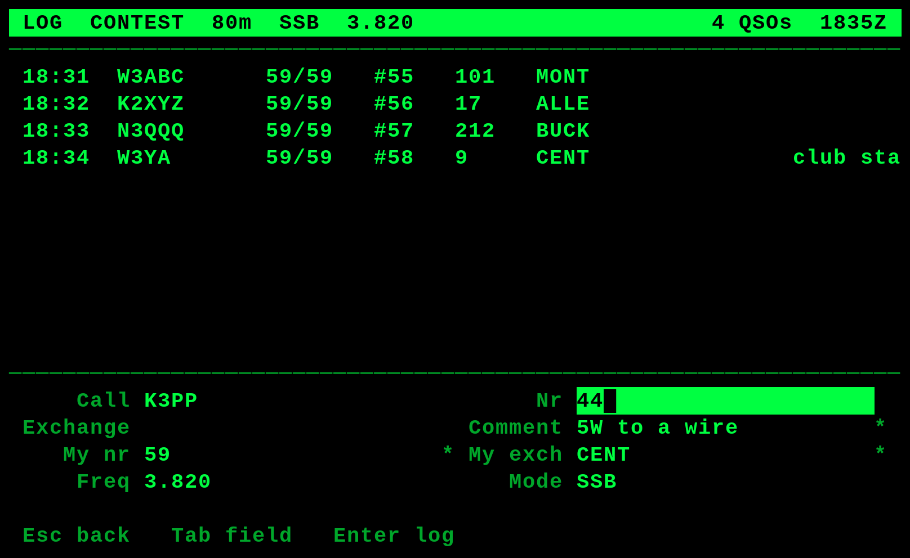

# Logging contacts on the cyberdeck

A walk through the contact log: switching it on, logging an ordinary QSO, a
park activation and a QSO party, and getting the contacts out afterward.

For the design and the reasoning behind it, see
[`qso_log_design.md`](qso_log_design.md). This is the operating side.

> **Status, 2026-10-11.** The log works today from a terminal or over SSH with
> `tools/qso.py`, and every screen below is rendered from the same functions
> the deck draws with. The panel side — Ctrl-N and the menu entry — is not
> wired into `cyberdeck.py` yet, so the screens show what it will look like
> rather than what you can press today. The design document says the same.

---

## 1. It is off

The log is off until switched on, and when off it does not exist: no key is
bound, no file is created, nothing runs in the main loop, and there is no field
in the status line. A deck that has never had logging switched on is
indistinguishable from one built without it.

Switch it on from the menu — `F1`, then Logging — or set `LOGGING = yes` in
`cyberdeck.conf`.



| Item | What it does |
|---|---|
| Logging | On or off, and how many contacts are in the file |
| Export ADIF | Write the whole log out for another program |
| Sign and upload to LoTW | Only when `tqsl` is installed — see §6 |
| Mode from | Where the logged mode comes from — see §5 |
| Callbook lookup | Look callsigns up when there is a network — see §4 |
| Activity | Which fields get typed, and in what order — see §3 |
| My reference | This station's park or summit, when an activity uses one |

Items that cannot do anything are absent rather than greyed out. No QRZ key
means no QRZ item; no `tqsl` means no LoTW item; no activity with a reference
means no `My reference` line.

---

## 2. Logging an ordinary contact

`Ctrl-N` opens the log screen. `Esc` goes back to the transcript.



The whole display is the log, because on SSB the transcript has nothing on it
worth reading.

Type the callsign, then whatever else you caught:

```
W1AW                        just the call — reports default to 59
W1AW 57                     one report is the one you RECEIVED
W1AW 59 57                  sent, then received
W1AW 59 57 Ann Newington    and a name, and the rest as the QTH
```

`Enter` commits. `Esc` cancels.

**Anything after a semicolon is a comment** and is not parsed:

```
W1AW 59 57 Ann ; running 5W to a wire
```

The comment is the catch-all — "QRP", "first one from this county", "will send
a card". It is the last column on screen and the first thing truncated, because
everything to its left is a field you might need to read back.

**The date, time, frequency, band and mode are filled in for you.** Time is
UTC from the deck's real-time clock. Frequency comes from the radio. Mode is
§5.

Absent hardware is an ordinary condition: if the radio does not answer, the
contact still commits, with the frequency blank and a note on screen. A contact
with an unknown frequency beats a lost contact.

---

## 3. Activities: choosing which fields you type

This is the part worth understanding, because it changes what your typing
means.

An **activity** is a named, ordered list of fields. That list is also the entry
grammar. Three come built in:

| | You type | For |
|---|---|---|
| **General** | reports, name, QTH | everything else |
| **POTA** | reports, their park, name | park activations and hunting |
| **Contest** | their serial, their exchange | serial-and-exchange events |

All three record the frequency, band, mode, UTC time, both reports, and this
station's rig, antenna and transmit power. Name and grid come from a callbook
when there is a network, or get filled in later when there is one (§4).

Pick one from the menu:



Why it works this way: `599` is a valid signal report **and** a valid serial
number, and nothing about the token says which. No parser can tell them apart.
But you already know which you are typing — you chose the activity before you
started. So the activity resolves it once, instead of the deck guessing on
every contact.

### Parks on the Air

POTA is an **activity**, not a separate mode — selected the same way as any
other, including ones you define. With it selected the header says so and a
reference column appears:



```
W3ABC 59 57 US-1234         their park
W3ABC 59 57 US-1234 Bob     and their name
```

**Hunting needs no activity at all.** A park reference is recognized by its
shape in any activity, so working one park on an ordinary afternoon needs
nothing switched on. What the activity is for is *activating* — your own
reference goes on every contact, so it is a setting (`My reference`) rather
than something typed eighty times.

The reference column is drawn even while empty during an activation. A column
that appeared on your first park-to-park would shift every row under it.

### A QSO party or contest

With a serial-and-exchange activity selected, different columns appear:



```
W3ABC 101 MONT              their serial, their exchange
```

Reports are not typed — in a QSO party they are 59 every time, and leaving them
out is what frees the numeric slot for the serial. The `#55` column is the
serial **you sent**, which increments on its own.

**Your serial comes from the log, not a counter.** The deck reads the highest
serial already recorded for that activity and adds one. So it survives a power
pull, and it cannot drift out of step with what you actually sent — which is
the failure nobody notices until the log is checked.

### Defining your own

Only those three are built in. SOTA, WWFF, Field Day, Sweepstakes and the
state QSO parties are **examples to copy**, not defaults — a built-in nobody
uses is a line in the picker to scroll past forever.

Activities live in `~/.config/cyberdeck/activities.conf`. Start from
[`activities.conf.example`](../activities.conf.example):

```ini
[PAQP]
like = CONTEST               # start from a saved activity
label = Pennsylvania QSO Party
contest_id = PA-QSO-PARTY
label_exchange_rx = County   # the word you are listening for
```

`like` is the template mechanism: a state QSO party *is* a QSO party with a
contest id and a different word for the exchange, and saying that is better
than restating the field list and letting the two drift apart.

The fields an `entry` list may name, in any order:

| Field | Takes |
|---|---|
| `rst_s`, `rst_r` | signal reports |
| `serial_rx` | their serial number |
| `exchange_rx` | their exchange — a class, county, section |
| `park` | their park or summit reference |
| `name`, `qth` | their name and location |

What *you* send is not typed per contact: your exchange is a setting
(`EXCHANGE_TX`), your reference is a setting, and your serial increments on
its own.

A text field takes one word, **except in the last position, where it takes the
rest of the line.** That is how `1B EPA` is one Field Day exchange while
`Bob Pittsburgh PA` still splits into a name and a QTH.

A bad definition is refused when it loads, naming the section — an activity
that silently does not exist looks exactly like one that does nothing, and you
would find out mid-contact.

---

## 3a. Your rig, antenna and power

Every contact of every activity records this station's own equipment:

| Logged as | From |
|---|---|
| `MY_RIG` | the **Rig** field in the Station menu (`F1`, then Station) |
| `MY_ANTENNA` | the **Antenna** field, in the same menu |
| `TX_PWR` | the radio's power control, scaled by **Max power (W)** |

Rig and antenna come from the Station menu you already use — there is no
second place to set them, because a second place is a second place to be
wrong.

**Set `Max power (W)` to whatever your current setup can do.** hamlib reports
the power control as a position between 0 and 1, not a wattage, so the deck
needs the ceiling to turn it into watts:

```
watts = control position × Max power (W)
```

The ceiling is a setting rather than something looked up because it is **not a
property of the radio**. The FTX-1 does 6 W on its internal battery, 10 W on
external power, and 100 W docked in the Optima with the amplifier — same
radio, same control position, three different answers. So change this one
number when you change the setup:

| Setup | Max power (W) |
|---|---|
| Field, internal battery | 6 |
| Field, external power | 10 |
| Optima with the SPA-1 | 100 |

Leave it at 0 and nothing is recorded rather than something invented. `Power
(W)` below it is the fixed fallback for when the radio cannot be read at all.

This approach works on any radio hamlib can drive, which is the point — a
logger tied to one radio is worth less than one that is not. The deck does
also read the FTX-1's own power command when it answers, which reports watts
directly and says whether the amplifier is fitted, but that is a bonus layered
on top and not what the feature depends on.

> Not yet verified against a radio. Written from the rigctld and FTX-1 CAT
> documentation; it needs an evening with the rig connected. Every step
> records nothing rather than guessing when it cannot get an answer.

### In your message memories

The same three are available as message-memory tokens, beside the existing
`{call}`, `{name}`, `{qth}`, `{grid}` and `{rig}`:

```
RIG IS {rig} RUNNING {power} TO {ant}.
```

`{power}` is read from the radio at the moment you press the key, so a brag
line cannot claim 20 watts while you are sitting at 5. If neither the radio
nor the configuration can say, it expands to nothing — odd phrasing beats a
wrong number on the air.

---

## 4. Callsign lookup

With `Callbook lookup` on and a network, the name, QTH and grid are filled in
from three services in order:

| | Covers | Account | Gives the grid |
|---|---|---|---|
| callook.info | US only | none | when the FCC record is geocoded |
| HamQTH | worldwide | free | yes |
| QRZ XML | worldwide | free | usually **not** without a subscription |

The order is about the grid, not reputation. QRZ is last because the one field
it withholds from a non-subscriber is the one most worth having.

**Partial answers are filled in rather than accepted.** KD3CCO is the case that
proves it: callook has the name and town but an empty grid square, because that
FCC record was never geocoded, while HamQTH has `FN10`. So the chain keeps
asking until it has name, QTH and grid, or runs out of providers.

**What you typed always wins.** The lookup only fills blanks. You heard it on
the air; the database is reading a license record that may be a decade old.

### Filling them in later

Logged a park with the WiFi off? Run `qso.py backfill` when you are back on a
network. It looks up every call still missing a name or grid and remembers the
answers; the next `list` or `adif` shows them.

It does **not** rewrite the log. The log is append-only, which is what makes it
safe across a power pull, and a backfill that edited it in place would trade
the one property worth having for a convenience. The lookups go in the
callbook cache instead, and are merged at export time. Delete the cache and
you lose nothing but the lookups.

A lookup never holds up a contact. It runs in the background, and one still
running when you press Enter is simply not used.

Credentials go in `cyberdeck.secrets`, never `cyberdeck.conf` — which refuses
them outright, because it is the file meant to be safe to hand over.

> **HamQTH's username is your callsign, not your email address.** The email is
> refused with "Wrong user name or password", which looks like a wrong
> password and is not.

---

## 5. Where the mode comes from

The rule: **on digital, the mode is filled in from the deck; on voice, it is
not.** fldigi always has a modem loaded whether or not you are using it, so
asking "what modem is up" during a voice contact logs your 40-meter ragchew as
BPSK31.

`Mode from` picks the policy:

| | |
|---|---|
| `auto` | fldigi's modem when the rig reports a data mode or the deck is actually passing traffic; the rig's own mode otherwise |
| `fldigi, always` | the modem, whatever the rig says |
| `the rig, always` | never fldigi — what to set for an SSB session |

One sharp edge worth knowing: with **no CAT connection at all**, `auto` leans
digital, because the deck is a digital terminal first. If you are working SSB
from a park with no CAT cable, set `the rig, always`.

---

## 6. Getting the contacts out

The log is a plain text file, one contact per line, at
`~/.local/share/cyberdeck/qso.log`. It is append-only and fsynced on every
contact, so a power pull loses nothing already logged. It is readable and
editable over SSH, which is the recovery path for anything the interface gets
wrong.

`Export ADIF` writes the standard interchange format every other program reads.

| Destination | How |
|---|---|
| **A desktop logger** (QLog, and others) | Import the ADIF. This is the main path — the deck captures, your desktop logger owns the log |
| **POTA** | Upload the same ADIF at `pota.app` |
| **LoTW** | `qso.py lotw` writes the ADIF and prints the exact `tqsl` command to run |
| **QRZ** | Import the ADIF on the website |

**LoTW signing happens off the deck, deliberately.** A callsign certificate is
a private key and the deck's card travels in a backpack. There is also a
practical reason: with no certificate installed, `tqsl` **hangs** rather than
reporting an error — measured on 2.8.6 — so every call the deck makes to it
carries a hard timeout.

LoTW itself is free; it needs a certificate, not a subscription. That is
unrelated to the QRZ logbook, which needs a paid one.

---

## 7. From a terminal, today

Everything above works now over SSH, before the panel side exists:

```bash
qso.py log W1AW 59 57 Ann Newington         # a contact
qso.py log --comment "5W to a wire" K2XYZ   # with a note
qso.py log --lookup OK2CQR 59 55            # fill name/QTH/grid
qso.py log --activity PAQP --exchange-tx CENT W3ABC 123 MONT
qso.py log --pota --my-park US-5678 N3QQQ 59 57 US-1234

qso.py activities                            # every activity and its fields
qso.py list                                  # recent contacts
qso.py count                                 # how many, and on what
qso.py adif log.adi                          # export
qso.py lotw log.adi                          # export + the tqsl command
```

`--operating voice` overrides the mode policy for one entry, which is the quick
way to log an SSB contact on a deck configured for digital.
